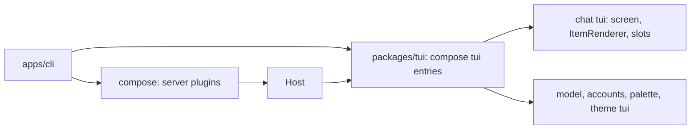

# Plan: milestone 2, the TUI

The session view, `packages/tui`, and the `tui` entries of `chat`, `palette`, `theme`, `model` and `accounts`. Work list: [plugins/tui.md](../plugins/tui.md). Designs: `apps/gallery`, plan in [_archive/gallery.md](_archive/gallery.md).

## Systems

| System | Change |
| --- | --- |
| `packages/client` | Expands: the session view beside `Host` |
| `packages/tui` | Adds the renderer, slots, the bridge between Effect and Solid, and the UI kit |
| `packages/plugins/chat` | Adds the chat screen as a `tui` entry |
| `packages/plugins/{palette,theme}` | Adds the command palette and theme switching |
| `packages/plugins/{model,accounts,loop,session}` | Expands: `tui` entries for the model picker and `/connect`; RPC for paging, loop state with the queue, and the session list |
| `apps/cli` | Expands: the TUI by default, `--model`, `--session` |

## Today

How a frontend reads a session now (`apps/cli/src/print.ts`):

| Step | What does it |
| --- | --- |
| Open a session | `SessionRpc` `session/open` |
| Send input | `LoopRpc` `loop/send` with a `session/message` event |
| Follow it | `SessionRpc` `session/live`: saved events after a `seq`, then deltas and new events |
| Know the turn ended | A `loop/turn-end` event |
| Show text | Decode each item with its kind's `EventKind.decode` |

Event kinds a viewer sees today: `session/message`, `session/notice`, `loop/turn-start`, `loop/step-start`, `loop/step-end`, `loop/turn-end`, `loop/interrupted`, and the records `system-prompt` and `tool-definitions` log. Deltas: `loop/reply` (text, reasoning, tool input, tool calls, retries) and `loop/tool-done`.

Prior art:

| Source | How it turns events into state, and loads screens |
| --- | --- |
| `archive/packages/frontend` | Its own slot tree and part loader, about 700 lines; each part declared the slots it needed |
| `archive/packages/plugins/chat/src/tui/transcript-state.ts` | The chat screen's own fold: entries into transcript items, tool runs grouped |
| OpenCode `packages/client/src/solid/data.ts` | One 2,000-line switch over every event kind into a Solid store with `reconcile`; closed to plugins |
| OpenCode `packages/tui/src/plugin/` | Its own plugin API and loader for TUI plugins |

## Decisions

- **The session view is generic.** It keeps the saved events in order, the reply streaming now and whether a turn runs. Screens decode the kinds they need; `chat` builds the transcript itself, and a plugin that owns questions or actors builds those in its own `tui` entry. Plugins add event kinds, so code in `client` cannot know them all.
- **The session view is Effect-native.** Sending, cancelling and answering stay RPC calls on `LoopRpc`. `packages/tui` turns `state.changes` into a Solid store, reconciled by `seq` so unchanged rows stay mounted.
- **`running` comes from `loop`.** `loop/state` streams whether a turn runs in the session, from `loop`'s own state. The events a view holds may not reach back to the turn's start, and after a crash the log shows a turn open that nothing runs. OpenCode asks the server for active sessions the same way.
- **One `loop/state` stream.** It holds `running` now; step 7 adds the queued inputs to it instead of a separate queue RPC. Both are live state `loop` keeps per session.
- **`streaming` is every delta since the last saved event.** The view keeps them as they come, of any kind; `chat` drops the reply items before a retry. The view stays a plain list that knows nothing of how `loop` replies.
- **A failed live stream stops the view.** It logs the error and stops updating. Reconnecting from the last `seq` comes with the IPC and HTTP hosts, where connections drop.
- **The view keeps what it loads.** It opens with the latest page, adds every new event, and `loadOlder` adds the page before the oldest held, back to the first. Nothing held is dropped.
- **The transcript opens at the bottom.** Its first frame shows the latest items; it never scrolls down after loading.
- **`loop/turn-start` marks a turn's start.** It is saved in the same write as the input the turn takes; the model never sees it. Any event kind can be an input, so the log alone cannot say when a turn starts.
- **`loop/reply` streams tool input.** A `tool-input` variant carries a call's params so far, parsed from the unfinished JSON in Effect AI's `tool-params-start` and `tool-params-delta`, so a tool row draws its input as it is written with the same params shape as the finished call. Pi does the same.
- **`loop` logs steps.** `loop/step-start` (with the model id) and `loop/step-end` are saved around each model call; the model never sees them. Every step start gets an end: `finished`, `failed`, `cancelled`, or `interrupted` when Liminal stopped, as OpenCode, deepseek-harness and Pi each close every model call.
- **Frontend code shared by `tui` and `web` lives in `view.ts`.** A plugin's `src/view.ts` or `src/view/` uses no UI framework; its `tui` and `web` entries import it and the server never does. `chat`'s holds the code that builds the transcript, so the desktop app reuses it. The plugin anatomy check and lint rules learn the new fixed file.
- **Plugins add frontend exports.** Beside `./contract`, a plugin exports `./view` (no UI framework) and `./tui` (OpenTUI), later `./web`. `/contract` is importable anywhere, `/view` from `view`, `tui` and `web` code, `/tui` from `tui` code only. `contract.ts` cannot hold a tag typed with a Solid component, since servers import it.
- **Plugins say which events make one transcript item.** `chat`'s `view.ts` holds `TranscriptRules`, after deepseek-harness's event definitions; its `tui` entry holds `ItemRenderer`, keyed by item kind. A part is one event, or one part of a `session/message`; parts with one item id make one item. An event no rule matches is its own item, of the event's kind. Streamed parts show as live items until saved.
- **Tool rows are not grouped.** A tool call and its result make one single-line row through `TranscriptRules`; consecutive tool rows sit next to each other, as in the gallery.
- **TUI and desktop share colors.** `theme`'s contract holds the role names, the `Palette` type, the setting and `theme/get`, `theme/set`; its `view.ts` holds the OKLCH math, ramps, palettes and the palette-to-role mapping. Its `tui` entry builds OpenTUI's `SyntaxStyle` and fills the UI kit's color context; a later `web` entry turns role colors into CSS variables. The UI kit owns `useColor` and that context and imports role names as a type. Spacing, borders, glyphs, fonts and syntax styles belong to each frontend. OpenCode keeps separate theme code for its TUI and web app, and their theme sets have drifted.
- **Slots.** `packages/tui` has one `screen` slot (`single_winner`) that `chat` fills. `chat` has `sidebar` (`append`, sections by `order`, its own Session section first) and `composer` (`replace`). A notifications slot comes with the first plugin that fills it.
- **Dialogs are a service, not a slot.** The UI kit's `Dialogs` is a stack with `open` and `close`, drawn above the screen with the dim. `model`, `accounts` and `palette` open their pickers through it from commands.
- **`ctrl+b` toggles the sidebar below 110 columns.** It is a named command, "Toggle sidebar", listed in the palette; `escape` closes the drawer, and a footer hint shows while the sidebar is hidden. It takes `ctrl+b` from OpenTUI's textarea, where the arrow keys do the same. Crush binds `ctrl+b`; OpenCode binds `ctrl+x b`.
- **`loop/step-end` carries token usage.** A finished one holds the finish reason and the call's token counts from Effect AI's `finish` part. The sidebar's context share is the latest step's tokens over the model's `contextWindow` from the catalog. `usage` in milestone 4 prices step-ends instead of attaching counts.
- **`tui` entries are plugins.** A plugin's `tui` module default-exports a plugin made with `definePlugin`; `packages/tui` composes them with `compose` over a base layer that provides `Host`, the renderer and the slot registry. `compose` gives the load order, missing-piece errors and cleanup, so `chat` provides `ItemRenderer` and `approvals` requires it.

```ts
// packages/client
interface ViewState {
  readonly events: ReadonlyArray<SessionEvent>   // saved, oldest first
  readonly streaming: ReadonlyArray<Delta>       // every delta since the last saved event
  readonly running: boolean
}
SessionView.open(session): Effect<{ state: SubscriptionRef<ViewState>; loadOlder: Effect<void> }, E, Host | Scope>
```

```ts
// chat/src/view.ts
interface TranscriptRule<S> {
  readonly kind: string                              // item kind
  readonly match: (part: Part) => string | undefined // item id
  readonly start: (part: Part) => S
  readonly update: (state: S, part: Part) => S
}
export const TranscriptRules: Registry<TranscriptRule<unknown>>

// chat/src/tui.tsx
export const ItemRenderer: Registry<{ kind: string; component: Component<{ item: Item }> }>
```



| Gallery piece | Goes to |
| --- | --- |
| Primitives, `Dialog`, `Picker` | `packages/tui` UI kit |
| Header, sidebar, composer, transcript, notifications, slash menu, landing, sessions picker | `chat` |
| Models picker | `model` |
| Connect dialog | `accounts` |
| Commands picker | `palette` |
| `useColor` | `packages/tui` UI kit |
| `oklch.ts`, `ramp.ts`, `palettes.ts`, `roles.ts` | `theme` `view.ts`; role names in its contract |
| `syntax.ts`, `theme.tsx` | `theme` `tui` entry |

## Build order

1. `loop` events. 2. Session view in `packages/client`. 3. Plugin anatomy: `./view`, `./tui`, `view.ts`. 4. `packages/tui`. 5. `theme`. 6. `chat`, with `liminal` opening the TUI. 7. `palette`, model picker, `/connect`, saved sessions, queue and pull-back, `Commands`.

## Step 1: `loop` events

Print mode's `--json` shows the new events with no change to `apps/cli`.

```text
packages/plugins/loop/
  README.md            the new events and the tool-input delta
  src/contract.ts      TurnStarted, StepStarted, StepEnded; ReplyDelta gains tool-input
  src/sessions.ts      a write that opens a turn puts TurnStarted first
  src/turn.ts          logs StepStarted, then the reply with StepEnded; a failed or cancelled step's end
  src/reply.ts         keeps the finish part and each call's input text; publishes tool-input
  src/partial-json.ts  new: best-guess params from unfinished JSON text
  src/recovery.ts      closes a step a crash left open
```

```ts
// contract.ts; Response is effect/ai's
export const TurnStarted = defineEvent("loop/turn-start", Schema.Struct({}))
export const StepStarted = defineEvent("loop/step-start", Schema.Struct({ model: ModelId }))
export const StepEnded = defineEvent("loop/step-end", Schema.Union([
  Schema.Struct({ outcome: Schema.Literal("finished"), reason: Response.FinishReason, usage: Response.Usage }),
  Schema.Struct({ outcome: Schema.Literals(["failed", "cancelled", "interrupted"]) }),
]))
// ReplyDelta gains; id is the tool call's id, params the input so far, whole
Schema.Struct({ type: Schema.Literal("tool-input"), id: Schema.String, name: Schema.String, params: Schema.Json })

// partial-json.ts
export const parsePartial: (text: string) => Schema.Json  // {} until something parses
```

None of the three events has a converter, so the model never sees them.

| Where a turn opens (`sessions.ts`) | Write |
| --- | --- |
| `send` on an idle session | `[TurnStarted, input]` |
| `release` after `Turns.fold`, inputs waiting | `[TurnStarted, ...inputs]` |
| `endTurn`, not answered, inputs waiting | `[TurnEnded]`, then `[TurnStarted, ...inputs]` |
| `endTurn`, answered, inputs waiting | `[...inputs]`: the same turn goes on |
| `takeSteers` | `[...steers]` |

`take` gains `opens: boolean`, which puts `TurnStarted` first.

```text
step (turn.ts)
  sync system prompt and tool list; run BeforeCall hooks
  request = request(session)
  append [StepStarted { model: request.model }]
  reply = streamReply(request), on failure append [StepEnded failed], on interrupt [StepEnded cancelled]
  append [message when it has parts, StepEnded finished { reason, usage }]
  no calls: run TurnEnd hooks, answered
  reason is length: fail the calls, else run them

streamReply (reply.ts), state { reply, inputs: call id -> { name, text }, finish: Option<FinishPart> }
  tool-params-start: inputs += id -> { name, text: "" }
  tool-params-delta: text += delta; publish tool-input { id, name, params: parsePartial(text) }
  finish: finish = the part
  retry: state starts over
  returns { message, finish }

parsePartial (partial-json.ts)
  scan text, tracking open strings, objects and arrays
  cut a half-written key or a value with no start, and a trailing comma or colon
  close the open string, then each open object and array, innermost first
  JSON.parse; {} when it still fails

closeUnfinished (recovery.ts)
  a turn is open when a TurnStarted follows the last TurnEnded
  a StepStarted after the last StepEnded since the last TurnEnded: StepEnded interrupted before the notice
```

- A reply that ends with no finish part logs `StepEnded` finished with reason `unknown` and empty usage.
- On a cancel, `reply.ts` logs `loop/interrupted` first, then the step logs `StepEnded` cancelled.
- `truncated` goes: it is `finish.reason === "length"`.
- `reply.ts`'s private `fold` becomes `addDelta`, so "fold" means only `Turns.fold`.
- Pi parses with the `partial-json` package; OpenCode keeps a 280-line copy of it. Ours covers what a tool's params need: objects, arrays, strings, numbers, `true`, `false`, `null`.

## Step 2: session view

No screen uses it until step 4; a scratch script checks it by hand.

```text
packages/client/
  README.md               the session view
  src/host.ts             Host and inMemory, moved from index.ts
  src/session-view.ts     new: open, ViewState, addItem, addOlder
  src/index.ts            exports Host, inMemory, SessionView
packages/plugins/session/src/{contract,index}.ts   session/page RPC
packages/plugins/loop/src/
  contract.ts             LoopState, Inbox.state, the loop/state RPC
  sessions.ts             states in a SubscriptionRef; state(session) stream
  index.ts                the loop/state handler
```

```ts
// session contract: SessionRpc gains
Rpc.make("session/page", {
  payload: { session: SessionId, before: Schema.optional(Seq) },
  success: Schema.Array(SessionEvent),
  error: Schema.Union([SessionNotFound, SessionStoreFailed]),
})

// loop contract: LoopRpc gains; the current state first, then each change
export const LoopState = Schema.Struct({ running: Schema.Boolean })
Rpc.make("loop/state", { payload: { session: SessionId }, success: LoopState, stream: true })

// packages/client/src/session-view.ts, exported as SessionView
export interface ViewState {
  readonly events: ReadonlyArray<SessionEvent>  // saved, oldest first: the latest page and older pages loaded
  readonly streaming: ReadonlyArray<Delta>      // every delta since the last saved event
  readonly running: boolean
}
export interface SessionView {
  readonly state: SubscriptionRef<ViewState>
  readonly loadOlder: Effect<void, SessionNotFound | SessionStoreFailed>
}
export const open: (session: SessionId) =>
  Effect<SessionView, SessionNotFound | SessionStoreFailed, Host | Scope>
```

```text
open(session)
  sessionRpc, loopRpc = host.client(SessionRpc), host.client(LoopRpc)
  latest = session/page { session }
  state = SubscriptionRef { events: latest, streaming: [], running: false }
  fork in scope: session/live { session, after: last seq or 0 }, each item: state = addItem(state, item)
  fork in scope: loop/state { session }, each: state.running = running
  a forked stream that fails logs the error; the view stops updating

addItem(state, item)                  pure
  saved event, seq above the last held: events += item, streaming = []
  saved event, seq held already: state
  delta: streaming += item

loadOlder
  first held seq is 1, or nothing held: done
  older = session/page { session, before: first seq }
  events = older with seq below the first held, then events

loop/state (sessions.ts)
  SubscriptionRef.changes(states), running = Option.isSome(state.running), Stream.changes
```

- `live` after the page's last `seq` catches up on events saved between the two calls, so nothing is lost.
- `streaming` matches the deltas `session` keeps for a viewer that joins mid-reply, so a view opened late sees the same.
- A screen knows there is more history when `events[0].seq` is above 1.

## Step 3: plugin anatomy

Tooling only; the first `view.ts` and `tui` entry come with `theme` in step 5.

```text
tools/lint/plugin-entries.ts     PluginEntry gains "view"; src/view.ts file, src/view/ folder
tools/lint/plugin-rules.ts       plugin-imports by entry; entry-isolation by table; new view-imports
tools/lint/plugin-rules.test.ts  cases for each
.oxlintrc.json                   turns on liminal/view-imports
tools/checks/plugin-anatomy.ts   "./view" export; folder targets
tools/checks/fixtures/           good: a ./view export, a tui folder; broken: messages updated
docs/instructions/plugins.md     Checked section
```

Which other plugins' exports each importer may use (`plugin-imports`):

| Importer | `/contract` | `/view` | `/tui` | `/web` |
| --- | --- | --- | --- | --- |
| contract, plugin, test, other files | yes | | | |
| view code | yes | yes | | |
| tui code | yes | yes | yes | |
| web code | yes | yes | | yes |
| `packages/client`, `packages/tui` | yes | | | |

Which of its own entries a file may import with a relative path (`entry-isolation`):

| From | May import |
| --- | --- |
| plugin | plugin; tui and web only with `import()` |
| view | view |
| tui | tui, view |
| web | web, view |

Contract and test files stay outside the table, as now.

```ts
// plugin-rules.ts
const allowedSubpaths: ReadonlyMap<PluginEntry, ReadonlySet<string>>  // the first table
const reaches: ReadonlyMap<PluginEntry, ReadonlySet<PluginEntry>>      // the second table

/** View code uses no UI framework. */
export const viewImports  // in view code: bans solid-js, @opentui/*, @shanepadgett/liminal-tui

// plugin-anatomy.ts: each export and the files it may point to
const entryFiles = new Map([
  [".", ["./src/index.ts"]],
  ["./contract", ["./src/contract.ts"]],
  ["./view", ["./src/view.ts", "./src/view/index.ts"]],
  ["./tui", ["./src/tui.tsx", "./src/tui/index.tsx"]],
  ["./web", ["./src/web.tsx", "./src/web/index.tsx"]],
])
```

- A folder entry's export points to its `index` file.
- The guide in `docs/guides/plugins.md` gains `tui` entries in step 4, when a plugin can ship one.

## Step 4: `packages/tui`

One step: the runtime (renderer, entries, slots, bridge, dialogs) and the UI kit copied from the gallery, checked by hand with a scratch `tui` entry.

```text
packages/tui/
  package.json        exports "."; dependencies @opentui/core, @opentui/solid, @opentui/keymap, solid-js;
                      peers effect, liminal-core, liminal-client
  README.md
  src/index.ts        run, Slots, defineSlot, SlotView, screen, Dialogs, Colors, useColor, useRun, useWatch, useSessionView, kit
  src/run.ts          loads tui entries, composes them over the base, renders the root, waits for quit
  src/base.ts         the base plugin: Host, Renderer, Slots, Dialogs
  src/root.tsx        the root plugin: requires Colors, renders screen slot and dialog layer
  src/slots.tsx       SlotHandle, defineSlot, Slots, SlotView over OpenTUI's registry
  src/dialogs.tsx     the Dialogs stack and its layer
  src/bridge.ts       useRun, useWatch, useSessionView: Effect into Solid
  src/colors.ts       Colors, useColor, useSyntax, useMix
  src/kit/            primitives, Overlay, Dialog, Picker, copied from apps/gallery
packages/plugins/theme/
  package.json, README.md, src/contract.ts   RoleName, Palette types only; the rest in step 5
  src/index.ts        a plugin with no services, since every plugin package has one
```

```ts
// run.ts
export const run: (plugins: ReadonlyArray<AnyPlugin>) =>     // AnyPlugin now exported from core
  Effect<void, CompositionError | EntryInvalid, Host>          // own scope: the terminal is restored first
class EntryInvalid extends Schema.TaggedError  // { plugin }: its tui entry does not default-export a plugin

// slots.tsx
interface SlotHandle<Props> { readonly name: string; readonly mode: SlotMode }
const defineSlot: <Props extends object>(name: string, mode: SlotMode) => SlotHandle<Props>
class Slots extends Context.Service<Slots, {
  readonly fill: <P>(slot: SlotHandle<P>, component: (props: P) => JSX.Element, order?: number) =>
    Effect<void, never, Scope>   // unregisters when the scope closes
}>
function SlotView<P>(props: { slot: SlotHandle<P>; children?: JSX.Element } & P): JSX.Element
const screen: SlotHandle<{}>    // "screen", single_winner

// dialogs.tsx: sync, since key handlers open them
class Dialogs extends Context.Service<Dialogs, {
  readonly open: (dialog: () => JSX.Element) => () => void   // returns close
  readonly close: () => void                                 // closes the top one
}>

// colors.ts: provided by theme's tui entry
type RoleColor = (role: RoleName) => string     // RoleName from liminal-theme/contract, as a type
class Colors extends Context.Service<Colors, {
  readonly color: Accessor<RoleColor>; readonly syntax: Accessor<SyntaxStyle>
  readonly mix: (from: string, to: string, amount: number) => string  // OKLCH math stays in theme
}>

// bridge.ts: in components
useRun(): <A, E>(effect: Effect<A, E, Host | Dialogs>) => void            // failure logged
useWatch<A>(stream: Stream<A>, initial: A): Accessor<A>                   // stops with the component
useSessionView(session): { state: ViewState (Solid store, reconciled by seq), loadOlder: () => void }
```

```text
run(plugins)
  entries = each plugin with entries.tui: import it, default export must be a plugin, else EntryInvalid
  renderer = acquireRelease(createCliRenderer({ exitOnCtrlC: false }), destroy)
  compose([base(host, renderer), ...entries, root]) missing Colors: CompositionError
  wait until the renderer is destroyed

base(host, renderer)                                plugin, provides Host, Renderer, Slots, Dialogs
  registry = createSolidSlotRegistry(renderer, {})

root                                                plugin, requires Host, Colors, Slots, Dialogs, Renderer
  runner = FiberSet.makeRuntime, in the composition's scope
  render(<Services runner colors dialogs><KeymapProvider>
           <SlotView slot={screen}>no screen</SlotView>
           <DialogLayer />          top dialog in an Overlay; escape closes it
         </KeymapProvider></Services>)
  ctrl+c: "Quit", destroys the renderer; chat takes it over in step 6

a tui entry (tui.tsx)
  export default definePlugin({ name, provides, requires: [Slots, ...], layer: Layer.effectDiscard(
    Effect.gen: slots = yield* Slots; yield* slots.fill(screen, () => <ChatScreen />)) })
```

- The gallery keeps its own code and stays free to change; `packages/tui` copies what it takes, and neither imports the other.
- A component reaches its plugin's services through its layer's closure, and the base's through `useRun`.
- `root` is the last plugin, so it renders after every entry fills its slots, and a composition without a theme fails to start.
- `liminal` loads `packages/tui` with `import()` after `@opentui/solid/preload`, so `.tsx` compiles wherever it runs; that wiring comes with step 6.

## Events in the references

| Signal | Pi | OpenCode | deepseek-harness | Liminal |
| --- | --- | --- | --- | --- |
| Turn start and end | `turn_start`, `agent_end` | `execution.started`, `.succeeded` | `turn/start`, `turn/end` | `loop/turn-start`, `loop/turn-end` |
| Step: one model call | `turn_start` per response | `step.started`, `.ended`, `.failed` | `step/start`, `step/end` | `loop/step-start`, `loop/step-end` |
| Text and reasoning as written | `message_update` | `text.delta`, `reasoning.delta` | `agent/assistant-stream` | `loop/reply` |
| Tool input as written | `message_update` with `toolcall_delta` | `tool.input.delta` | in the stream | `loop/reply` `tool-input` |
| Tool output as it runs | `tool_execution_update` | `tool.progress` | no | none |
| Retry | `auto_retry_start` | `retry.scheduled` | `assistant/attempt` | `loop/reply` retry |
| Queue | `queue_update` | `inbox.enqueued`, `.delivered`, `.cancelled` | `agent/inbox/*` | planned in `loop/state` |
| Model change | `model_change` | `model.selected` | no | none |
| Usage | `usage` | `usage.updated` | `token-meter` | `loop/step-end` |
| Compaction, rename, fork | yes | yes | yes | milestones 4 and 5, Later |

Effect AI streams tool input as `tool-params-start`, `tool-params-delta` and `tool-params-end` (`effect/ai` `Response`); `loop` publishes the first two as `tool-input`.

## deepseek-harness frontends

- Browser plugins use the same plugin framework (Cordis) as the server, and the desktop app loads the same web app.
- Framework-free layers sit under the renderer: `client/store` for state, `client/ui-slots` for slot definitions, `client/ui-conversation` for a target-neutral conversation built from events by a registry of event definitions. Only `client/ui-renderer` knows React.
- One root slot; its occupant owns the layout.

## Open

None.
